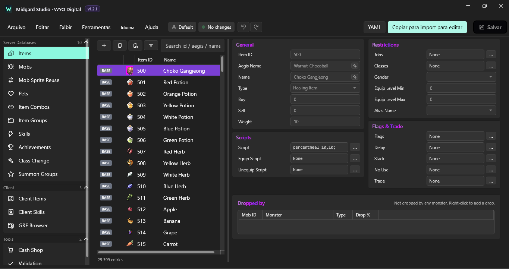
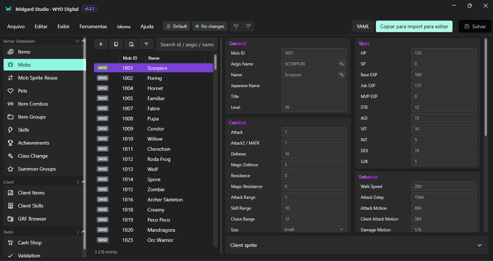
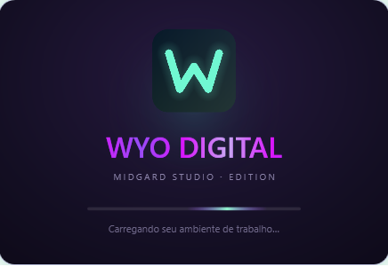

<div align="center">

# Midgard Studio · WYO Digital Edition

**Editor de dados de servidor e cliente — Windows 10/11 x64**

**Edição WYO Digital 1.2.1 Preview** · Aplicativo portátil · Sem instalação do .NET · Gratuito para uso permitido pela licença

</div>

## Capturas reais do WYO Digital Edition

As três capturas abaixo correspondem às telas **Itens**, **Monstros** e **Carregamento** do aplicativo WYO Digital Edition v1.2.1.

> **Imagens pendentes de envio:** os links abaixo estão preparados para receber os PNGs originais. Até que os arquivos sejam enviados à pasta `screenshots/`, o GitHub poderá mostrar imagens indisponíveis. Nenhuma imagem foi simulada.

### Editor de Itens



### Editor de Monstros



### Tela de carregamento



## Download — aplicativo pronto

**[Baixar a versão Windows em Releases](../../releases)**

Se ainda não houver uma Release, acesse **[Actions → Compilar aplicativo WYO Digital](../../actions/workflows/windows-portable.yml)**, abra uma execução com status **Success** e baixe o artefato **MidgardStudio_WYO_Digital_Windows_x64**.

1. Extraia o pacote em `D:\GAME\MidgardStudio_WYO_Digital\App`.
2. Execute **`Iniciar_WYO_Studio.bat`** (recomendado: mantém dados e cache do .NET no disco D).
3. Alternativamente, clique diretamente em **`Midgard Studio WYO Digital.exe`**.
4. No primeiro uso, configure o caminho da pasta `db` **da sua cópia de desenvolvimento**. Evite usar o servidor em produção.

Não é necessário instalar Python, .NET ou ferramentas de compilação para executar o pacote portátil.

## O que faz

| Ferramenta | Funcionalidade |
|---|---|
| Bancos de dados | Edição assistida de itens, monstros, habilidades, combos, grupos e outros YAML compatíveis com rAthena |
| Item Forge | Criação guiada de itens com dados de servidor e cliente |
| Client editor | Arquivos de itens, skills, texto, sprites e ícones |
| GRF Browser | Leitura e visualização de GRF, mapas, modelos e sprites |
| Cash Shop | Configuração de itens e preços |
| Validador | Referências cruzadas, inconsistências e verificações antes de salvar |
| Proteção | Edição em camada import, undo/redo e backups de segurança |

**Importante:** a ferramenta não faz edição direta de GRF. Alterações são exportadas como arquivos de cliente; a montagem do pacote continua separada.

## Onde os dados ficam

A edição WYO **não usa automaticamente as configurações nem move os backups da versão original**.

```text
D:\GAME\
└── MidgardStudio_WYO_Digital\
    ├── App\            ← extraia aqui o aplicativo
    ├── config\         ← perfis, ajustes e preferências
    ├── backups\        ← snapshots de segurança
    ├── logs\           ← registros do aplicativo
    └── runtime-cache\  ← cache do .NET (usando o launcher BAT)
```

Padrão: `D:\GAME\MidgardStudio_WYO_Digital` quando `D:\GAME` existe. Em outro computador, o programa usa uma pasta separada em `%LOCALAPPDATA%\WYO Digital\MidgardStudio`. Use a variável de ambiente `WYO_MIDGARD_HOME` para especificar outra pasta absoluta.

O Windows e bibliotecas externas ainda podem usar arquivos temporários do próprio sistema. Para direcionar também o cache do executável single-file ao D, inicie pelo BAT.

## Proteções do projeto WYO

- Não altera o repositório protegido `JokerSamaBR/rathena-wyo-clean`.
- Para editar arquivos de jogo, escolha apenas uma cópia autorizada de trabalho.
- Salvar uma personalização deve respeitar as regras da camada `db/import` e dos arquivos customizados de cliente.
- Revise backups e validações antes de distribuir mudanças em um servidor.
- O aplicativo WYO não migra automaticamente configurações ou backups da instalação original.

## Licença e créditos

Esta edição é **derivada de Midgard Studio, criado por Kyoshio**. Direitos autorais e atribuição originais preservados.

A licença existente é **MIT com Commons Clause**, que **restringe a venda do software**. Não confundir com MIT pura ou com uma licença open-source irrestrita. Consulte [LICENSE](LICENSE) antes de distribuir ou comercializar. A licença também deve acompanhar os binários.

Bibliotecas de leitura GRF: componentes de Tokeiburu GRF Editor presentes em `lib/grf`. Verifique os termos dos componentes incluídos antes da redistribuição.

**WYO Digital Edition:** identidade, ajustes de armazenamento, documentação e empacotamento produzidos para WYO Digital. É uma edição independente; não representa o autor original.

## Compilar e testar (desenvolvedores)

Requisitos: Windows, SDK .NET compatível com os projetos (8.0 + 10.0 para solução `.slnx`).

```powershell
dotnet restore MidgardStudio.slnx
dotnet build MidgardStudio.slnx -c Release
dotnet test tests/MidgardStudio.Tests/MidgardStudio.Tests.csproj -c Release
dotnet publish src/MidgardStudio.App/MidgardStudio.App.csproj -c Release /p:PublishProfile=win-x64
```

O [GitHub Actions](.github/workflows/windows-portable.yml) executa build, testes e empacotamento de Windows x64 sem custo de serviço de IA.

## Atualizações

O verificador do aplicativo consulta **somente as Releases desta edição WYO Digital**, nunca as Releases do projeto original. Quando não existe Release mais recente, segue funcionando normalmente.

Acompanhe as novidades públicas da WYO em [www.wyoplay.com](https://www.wyoplay.com/) e [digital.wyoplay.com](https://digital.wyoplay.com/).

Consulte [CHANGELOG](CHANGELOG.md) e [WYO Edition](docs/WYO_EDITION.md) para diferenças em relação à base.


## Idioma da interface

No menu superior, escolha **Language → English** ou **Language → Português (Brasil)**. O idioma inicial é inglês; a escolha fica salva nas preferências do aplicativo e é restaurada na próxima abertura. A tradução atual cobre o menu principal e os comandos estáticos da janela principal. Algumas ferramentas e mensagens internas continuam em inglês enquanto os demais módulos são localizados. A troca não modifica arquivos YAML, GRF nem dados do servidor.

### Janela inicial

O aplicativo abre em janela normal de **1100 × 720** (unidades WPF), centralizada. O usuário pode maximizar ou redimensionar manualmente pelos controles do Windows. Dimensão mínima: 900 × 600. Não força tela cheia na inicialização.
